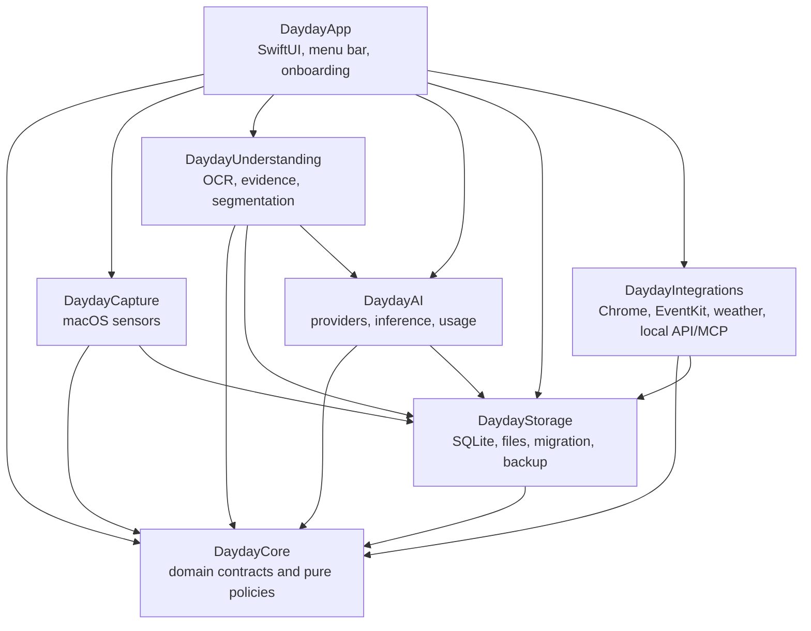
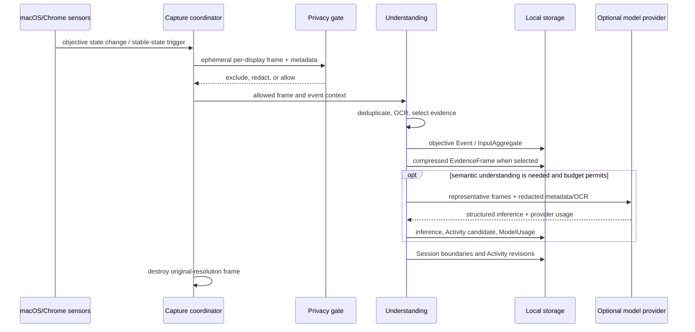

# Dayday Architecture

## Goals and invariants

Dayday is a native, local-first macOS application that turns objective computer activity into a
reviewable work timeline and an AI-assisted work report, while also providing an independent
personal journal. The first supported platform is Apple Silicon on macOS 14 or later.

The architecture must preserve these invariants:

- Capture continues without a cloud connection. AI enrichment is optional and retryable.
- Objective observations, model inferences, and user-approved conclusions remain distinguishable.
- Work-report code cannot read journal text or mood records.
- Original-resolution screen captures are ephemeral. Only selected, compressed evidence frames
  may be persisted.
- Typed text, keystroke order, exact mouse-event history, passwords, secrets, and incognito context
  are never persisted.
- No remote telemetry or hidden upload exists. Network traffic is limited to providers and
  integrations explicitly enabled by the user.
- Provider implementations and persistence implementations are replaceable behind Core protocols.

## Deployment shape

Version 0.1 is one signed-or-locally-built macOS process with three presentation surfaces:

- a menu-bar item and anchored popover for status and quick capture;
- a normal SwiftUI window for Today, Journal, History, Insights, and Settings;
- background actors for collection, understanding, persistence, retention, and model work.

Closing the main window does not stop collection. A future helper process is possible, but is not
required until process isolation or launch reliability justifies its operational cost. The Chrome
extension is an unpacked development extension in v0.1 and communicates through an authenticated
local native bridge.

## Module boundaries

All shared identifiers, value types, policies, and service protocols live in `Sources/DaydayCore`.
Core imports no application, platform-service, persistence, or provider module. Implementations may
coordinate at the composition root, but should not create circular module dependencies.

### DaydayCore

- Stable domain identifiers and the types described in `DATA_MODEL.md`.
- `WorkdayBoundary`, with a configurable hour in `0...23` (default `04:00`) and injected
  `Calendar`/time zone for deterministic day-start and same-workday calculations.
- Privacy/exclusion, retention, confidence-band, and budget policies as pure logic.
- Repository, clock, provider, and integration protocols.
- Explicit domain projections such as `WorkReportContext` and `JournalContext`.

### DaydayCapture

- ScreenCaptureKit capture for each connected display.
- NSWorkspace/Application Services observations for foreground applications and windows.
- Accessibility-derived control type and document/window metadata where authorized.
- In-memory keyboard and pointer accumulation using macOS event facilities.
- Sleep, lock, secure-input, display-topology, and permission-state handling.

Capture emits objective events and aggregates only. It does not create semantic Activity titles.

### DaydayUnderstanding

- Apple Vision OCR and local screen-change/perceptual-hash processing.
- Privacy filtering and evidence-frame selection before persistence or provider upload.
- Event-to-Session boundary construction.
- Cross-display Session-to-Activity candidate assembly.
- Evidence-linked facts, inferences, confidence bands, and user-correction application.

### DaydayAI

- Provider adapters, initially an OpenAI-compatible adapter, with task-specific model selection.
- Visual interpretation, Activity naming, work-report drafting, and optional journal-derived copies.
- Structured request/response validation and provider-neutral usage accounting.
- Per-provider visual-token estimation when a provider does not return billable usage.

The AI module cannot fetch arbitrary storage records. Callers provide a purpose-specific input
projection assembled outside the provider adapter.

### DaydayStorage

- SQLite-backed repositories and migrations.
- Evidence and journal-attachment file stores.
- Transactional writes, rolling local backups, JSON import/export, and Markdown export.
- Retention, evidence-cap enforcement, hourly-to-daily aggregation, and orphan-file cleanup.

API keys, bearer tokens, and integration credentials are stored in Keychain, never SQLite or
exports.

### DaydayIntegrations

- Chrome native messaging for active-tab title, domain, path, navigation, tab switch, and audio
  state; no page body, form values, query string, fragment, or incognito data.
- Read-only EventKit calendar and reminder projections in v0.1.
- A weather-provider adapter, initially Open-Meteo, using a user-selected city by default.
- A localhost-only authenticated HTTP API and MCP facade.

### DaydayApp

- SwiftUI scenes, navigation, settings, permission education, and accessible presentation.
- Menu-bar popover and global quick actions for work notes, journal fragments, and mood entries.
- View models that consume Core repositories/services; views do not reach directly into SQLite or
  provider SDKs.

## Capture and understanding pipeline

### Stable-state collection

Collection is driven primarily by stable state changes, not a blind fixed screenshot loop:

- application, window, Chrome tab, or display changes;
- typing, scrolling, navigation, or loading followed by a short stable period;
- a manual context capture or quick note;
- a low-frequency three-to-five-minute fallback when no other trigger fires.

Cooling and duplicate suppression prevent animations, video frames, or an unchanged reference
screen from causing repeated analysis. Raw images exist only long enough to filter, hash, OCR,
resize, and optionally analyze.

### Multiple displays

Every connected display has an independent capture stream, coordinate space, deduplication state,
and last semantic interpretation. The display receiving interaction is useful evidence, but it is
not the only meaningful display. Reference displays are re-analyzed when content, scrolling,
window, navigation, or semantic context changes; unchanged interpretations are reused. Media
displays are rate-limited and described using application/page/playback facts rather than frame
changes alone.

Displays are never stitched into a single ultra-wide model image. Activities may cite Sessions and
EvidenceFrames from several displays, for example coding on one display while consulting
documentation on another.

### Adaptive visual resolution

- The original frame exists only in volatile memory while being processed and is never written to
  a temporary file or any other persistent storage.
- A normal model request uses a resized full-frame view suitable for layout plus local OCR and
  metadata.
- Small text, source code, tables, or low-confidence regions may trigger a high-resolution crop.
- Persisted evidence is a compressed, redacted derivative, not the original. User pinning and
  Debug capture sampling can retain only such derivatives; Debug sampling is explicit, local-only,
  and separately removable.

## Semantic layers

Dayday uses three distinguishable layers:

1. **Fact:** directly observed application/window metadata, OCR text, input aggregate, display
   change, calendar item, or user-authored note.
2. **Inference:** a model or rule interpretation linked to supporting evidence and a coarse
   confidence band. Model confidence alone is not treated as calibrated probability.
3. **Conclusion:** a Session grouping, Activity title/category, or report statement produced from
   facts and inferences and possibly confirmed or corrected by the user.

Normal UI hides scoring details. Low-confidence material may be marked “needs review”; Activity
details can reveal judgment basis, and Debug builds can reveal the full trace. Work reports use
uncertain wording or omit weak conclusions rather than presenting guesses as fact.

## Time construction

- Events are timestamped in UTC and retain the relevant local time-zone identifier.
- Sessions record objective contiguous context on either a known display lane or the explicit
  system foreground workspace lane, with hard boundaries for lock, sleep, explicit pause, and
  configured idle rules. A missing display identity is never replaced with a fabricated ID.
- Activities combine one or more Sessions according to task meaning, not application identity.
  Short use of terminals, browsers, messaging, or reference material may remain within one task.
- Core `WorkdayBoundary` assigns records to a Day using an injected `Calendar` and time zone; its
  configurable hour is in `0...23` and defaults to 04:00 so a late-night task is not split at
  midnight.
- Activity span and detected-interaction duration are distinct. Unobserved input is described only
  as “no input detected,” never as absence, distraction, or loss of focus.

## Reports and journals

WorkReport and JournalEntry are sibling artifacts associated with the same Day. Neither depends on
the existence or completion of the other.

- Work-report context may include Activities, work notes, calendar/reminder summaries, confirmed
  todos, WeatherSnapshots as objective environmental context, and relevant objective facts.
- It cannot include any personal-side artifact: JournalEntry text, JournalFragment text,
  JournalAttachment content, JournalDerivedVersion content, or MoodEntry values. The restriction
  is enforced by a separate allowlisted repository projection, not just a prompt.
- A JournalEntry is user-authored and auto-saved throughout the day. Weather, mood, fragments, and
  an optionally expanded work-background panel are references, not automatically inserted prose.
- AI journal operations are explicit and produce a labeled derived copy. They never overwrite or
  silently correct the original journal text.

The default work report is free-form model prose rather than a fixed visible template. Structured
facts and trace links remain behind the generated text for review and regeneration.

## Provider and usage architecture

`ModelProvider` accepts typed, purpose-specific requests and returns a structured result plus
`ModelUsage`. Every request records provider, model, task, request identifier, image count,
transmitted image dimensions/detail, input/output/cache tokens when available, latency, failure,
pricing snapshot, and estimated or actual cost.

Budget enforcement uses, in order:

1. billable usage reported by the provider;
2. a versioned provider/model estimator;
3. a conservative preflight upper bound derived from provider rules and the transmitted payload.

If no reliable estimate is available, the upper bound is reserved before transmission; image count
remains diagnostic and is never the sole billing estimate. Reaching an AI budget pauses new remote
analysis, not local capture or objective persistence. Deferred work remains queued and visible.

## Local API and MCP

The v0.1 service binds only to loopback interfaces. It uses a random bearer credential stored in
Keychain, least-privilege scopes, bounded queries, rate limits, and a local audit log. The API and
MCP layer expose domain projections rather than database tables.

- Ordinary work-context queries exclude raw/ephemeral screen data and all journal/mood data. They
  may return weather only as an objective snapshot, not an inferred mood or causal explanation.
- Sensitive evidence reads require an explicit capability and are disabled by default.
- Mutations require explicit user confirmation in the app.
- Delete, bulk mutation, and settings mutation are not exposed in v0.1.
- Audit entries record caller, capability, endpoint, time, status, and affected identifiers without
  copying sensitive request or response bodies.

A first vertical-slice acceptance path is: an external Agent requests today’s Activities, work
notes, agenda, and todos; drafts a work report; and asks the user to confirm saving it.

## Concurrency and failure handling

Use Swift structured concurrency. SwiftUI-facing state is isolated to `@MainActor`; capture,
storage writes, provider queues, and retention run in dedicated actors. Bounded queues provide
back-pressure so capture does not create unbounded memory use while a provider or database is slow.

- Local objective writes are attempted before optional remote enrichment.
- Provider work is idempotent and retryable with stable request/job identifiers.
- Sleep, wake, display change, authorization revocation, and network loss are explicit state
  transitions.
- A migration or database-integrity failure stops writes and surfaces a recoverable error; it does
  not delete or recreate user data automatically.
- Notifications are limited to permission failure, prolonged capture failure, report readiness,
  low storage, and database errors.

## Diagnostics and quality gates

Debug builds may expose a local diagnostic inspector for capture decisions, evidence selection,
Session/Activity construction, provider request/response metadata, usage, and database health.
Secrets and prohibited input data remain redacted in Debug. Release builds keep only minimal,
rotating local operational logs and contain no remote analytics SDK.

Tests are required for Core transformations and policies, privacy filters, usage accounting,
database migrations, retention/rollups, work-report isolation, and failure recovery. The initial
real-world release gate is two weeks of continuous use without data loss, with useful daily work
reports requiring no more than about three minutes of review.
