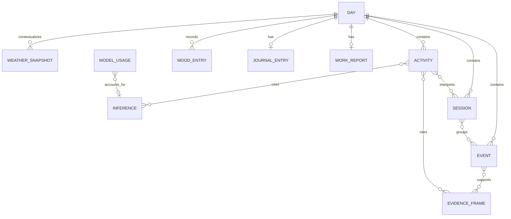

# Dayday Data Model

## Modeling rules

- Domain identifiers are opaque UUID-backed values, not database row numbers.
- Instants are stored in UTC. Records that depend on civil time also retain an IANA time-zone
  identifier and a derived `DayID`.
- User-authored values and user corrections are never overwritten by a later model pass.
- Facts, inferences, model provenance, and user conclusions remain separately addressable.
- File-bearing records store an opaque relative file-store key, never a machine-specific absolute
  path.
- Tombstones or deletion journals are used where required for safe cleanup and import; destructive
  schema behavior must not be implicit.

This document specifies domain semantics. A concrete SQLite schema may normalize fields further,
but must preserve these contracts and use migrations for changes.

## Identity and time

### Day

`DayID` identifies a logical user day under Core `WorkdayBoundary`. The boundary accepts a
configurable hour in `0...23` (default `04:00`) and uses an injected `Calendar` and time zone for
deterministic day-start and same-workday calculations. A DayID is not just an ISO calendar date. A
Day stores:

- `id`, display date, time-zone identifier, and boundary used;
- creation/update timestamps;
- optional links to one WorkReport and one JournalEntry;
- summary caches that can be rebuilt from source records.

Changing the configured boundary affects future assignment by default. Retrospective reassignment
must be an explicit migration/rebuild operation.

## Work observation hierarchy

### Event

An Event is an objective, timestamped observation from a collector. It is not an assertion about
the user's goal, attention, productivity, or emotion.

Common fields:

- `id`, `dayID`, `occurredAt`, optional end time, source, and event kind;
- optional opaque application identifier, bounded display-label snapshot, and privacy-filtered
  window/document metadata; raw bundle identifiers remain ephemeral and are not persisted;
- optional display identifier and topology revision;
- optional Chrome domain/path/title or media-state metadata under the Chrome privacy policy;
- collector version and payload schema version;
- privacy disposition and links to supporting EvidenceFrames.

Persisted Events include state transitions, stable-state observations, user actions such as quick
notes, and aggregate snapshots. Individual key presses, individual pointer positions, and exact
click events are not Events and never enter storage.

### Session

A Session is an objective interval assembled from related Events with a stable application/window,
document/tab, display, or interaction context.

- `id`, `dayID`, start/end, and boundary reason;
- event references and display/application context summary;
- detected-interaction duration and no-input intervals;
- optional media playback facts;
- derivation version and supersession link when rebuilt.

Lock, sleep, explicit pause, privacy exclusion, and configured idle boundaries are hard Session
boundaries. Application switching alone does not imply a new Activity.

### Activity

An Activity is a semantic, editable interpretation of one or more Sessions that served a common
task. It is a conclusion, not a raw sensor record.

- `id`, `dayID`, start/end, title, optional summary;
- ordered Session references, possibly from several displays/applications;
- optional user-owned project, one primary category, and multiple tags;
- detected-interaction duration kept separately from Activity span;
- fact and inference references, confidence band, and review state;
- source (`model`, `rule`, `user`, or mixed), derivation version, and supersession history;
- user override fields and timestamps.

User edits to title, category, project, tags, membership, split, or merge take precedence over later
automatic runs. There is no focus, distraction, or productivity score.

## Evidence and interpretation

### EvidenceFrame

An EvidenceFrame is a selected, compressed derivative used to explain an Event or Activity. It is
not the original screen capture.

- `id`, capture time, display identifier/topology revision;
- relative file-store key, pixel size, encoding, byte count, and content hash;
- optional crop region relative to the source display;
- redaction/filter result, source reason, expiration/pinned status;
- optional OCR-artifact link and model-request links.

Normal frames expire after the configured short retention period, initially seven days, and also
count toward a capacity limit. Pinned evidence and explicitly enabled debug samples are still
compressed, redacted derivatives and have separately visible policies; neither may retain the
original full-resolution frame. Expired EvidenceFrame references remain safely distinguishable
from missing or corrupt files.

### ObservationFact

An ObservationFact is a normalized proposition directly supported by one or more Events,
EvidenceFrames, OCR artifacts, integration records, or user-authored work notes.

- `id`, typed predicate/value, temporal scope, evidence references;
- producing component/version and redaction state.

Examples include “Xcode was foreground,” “the visible document contained `ScreenCaptureKit`,” or
“media playback was active.” “The user was implementing capture” is not a fact.

### Inference

An Inference is an interpretation produced by a rule or model.

- `id`, task kind, statement/structured payload, temporal scope;
- supporting and conflicting fact/evidence references;
- coarse confidence band (`low`, `medium`, `high`) and factors;
- model/provider or rule provenance, prompt/schema version, and ModelUsage link;
- review status and optional user correction.

Confidence is an operational routing signal, not a statistically calibrated percentage. Weak
inferences are omitted or cautiously phrased in downstream reports.

### OCRArtifact

OCR output is locally derived evidence with explicit bounds and provenance. Store only content that
passes privacy filtering, for the shortest useful period, and avoid duplicating large screen text
in logs or API audit entries. OCR must not process or persist prohibited screens and fields.

## Objective usage aggregates

### InputAggregate

InputAggregate stores an hour-level or rolled-up day-level summary; it never stores raw event
order.

- `id`, `dayID`, period start/end, granularity, and time zone;
- physical-key counts by hardware key code for the global keyboard heat map;
- total key count by application, without per-key-per-application distribution;
- left/right/other click counts, scroll deltas, and estimated pointer distance;
- normalized pointer/click grid per display and display topology revision;
- collector/layout version and exclusion-adjusted duration.

Raw key and pointer events exist only in memory until aggregated. Secure input, lock/login,
incognito, password managers, user-excluded applications/sites, and explicit pauses produce no
aggregate contribution. Hourly aggregates are retained for 180 days, then compacted into daily
aggregates retained until the user deletes them.

### AppUsageAggregate

Application duration and switching facts may be aggregated by hour/day for charts. Window titles,
browser domains, and other detailed context have separate permissions and retention. Aggregate
duration does not imply focus or productivity.

## Work artifacts

### WorkNote

A user-authored work note may link to the current Event, Session, Activity, project, category, or
tags. It is eligible for work-report context. It is not a JournalFragment.

### TodoItem

A lightweight TodoItem has a state (`pendingConfirmation`, `todo`, `done`, or `cancelled`), source,
optional Activity/project link, title, and due/completion times. AI-discovered candidates start in
`pendingConfirmation`. Calendar/reminder integrations remain distinct external references.

### WorkReport

One current WorkReport may be associated with a Day, with prior revisions retained.

- `id`, `dayID`, status (`draft` or `final`), free-form Markdown/text body;
- source objective application Event, H2 Activity, WorkNote, calendar/reminder, TodoItem, and optional objective WeatherSnapshot
  references;
- generator kind/model, generation time, prompt/schema version, and ModelUsage reference;
- production schema v2 persists report-specific `PersistedWorkReportNote` and `WeatherSnapshot`
  bodies atomically with the referencing generated revision. Activity and visual lineage continue
  to resolve through their existing repositories. Calendar/reminder/todo references remain part of
  the contract but are not populated by the current production assembler.
- revision lineage, user edits, and finalization timestamp.

The default body has no fixed visible template. WorkReport input types are an explicit work-data
allowlist and structurally exclude journal text, journal fragments, journal attachments, journal
derived versions, and mood entries. Weather can be supplied only as objective environment data;
the pipeline must not infer mood or causal impact from it.

## Personal artifacts

### JournalEntry

There is at most one current JournalEntry per Day, editable throughout the day and independent of
WorkReport existence or state.

- `id`, `dayID`, 一份当前 user-authored Markdown/plain-text body；普通实时保存就地更新该原文，不制造自动版本；
- creation/update timestamps；显式 AI 操作的衍生版本与原文分开保存；
- attachment and JournalFragment references;
- optional links to weather/mood records for display;
- zero or more labeled JournalDerivedVersion records.

The original entry is authoritative. Automatic spelling correction, rewriting, or model completion
is off. Explicit AI operations create a derived copy with model/time/operation provenance and never
overwrite the original.

### JournalFragment

A private, user-authored fragment collected during the day. It may be displayed beside or inserted
into a JournalEntry only by the user. It is never eligible for WorkReport context.

### JournalAttachment

V0.1 supports local images and links. The type system reserves audio, video, and generic-file
attachments for later versions. Private images are not submitted to a visual model by default.

### JournalLocationSnapshot

A `JournalLocationSnapshot` is an optional, explicit, single-point location that a person records
while writing. It belongs only to the journal entry and never to WorkReport input:

- WGS-84 latitude/longitude, altitude when Core Location supplies it, timestamp, and the reported
  horizontal/vertical accuracy in metres;
- no precision is implied beyond the reported accuracy; the UI must show it rather than claiming an
  exact place when the system could not obtain one;
- a snapshot is captured only after a deliberate in-editor action, never in the background, never
  as a continuous route, and never inferred from an image or browser/application activity;
- retained locally until the person deletes it and never sent to an AI provider or work-facing API.

### MoodEntry

A user-authored instantaneous mood record:

- timestamp and optional Day link;
- pleasantness and energy values;
- optional emotion labels, short reason, and work/life/unclassified scope;
- an optional day-level “overall feeling” marker.

Mood is never inferred from computer activity and is not available to work-report generation.

## Environmental context

### WeatherSnapshot

WeatherSnapshot records a small number of contextual observations for a user-selected city:

- observation/forecast time, city-level location identifier and time zone;
- provider and provider schema version;
- conditions, temperature/feels-like, daily high/low, precipitation, humidity, wind, sunrise, and
  sunset when available;
- retrieval time and attribution metadata.

The default source is a fixed city, requiring no location permission. Optional current-location use
for weather stores only city-level context. The separate journal-only `JournalLocationSnapshot`
may store an explicitly requested precise point under its stricter consent and isolation rules.

## AI accounting

### ModelUsage

One ModelUsage record represents one provider attempt, including failed attempts when billable:

- `id`, job/request identifier, provider, model, endpoint/task, and timestamps;
- input, output, cache-read/cache-write, and provider-reported total/billable tokens;
- image count, each transmitted image's dimensions/detail/media resolution, and byte count;
- provider-reported image/vision units when available;
- latency, success/failure class, retry relationship;
- currency, input/output/cache/image prices and effective-date/version snapshot;
- actual provider-reported cost when available, otherwise estimated cost and estimator version;
- budget-accounting status.

Provider-reported billable usage is authoritative. Versioned model-specific estimation is second.
If neither is reliable, a conservative upper bound derived from provider rules and the complete
transmitted payload is reserved before sending. Image count remains diagnostic and is never the
sole cost estimate.

## Retention summary

| Record | Default retention |
|---|---|
| Original-resolution capture | Ephemeral; destroyed after processing |
| Compressed EvidenceFrame | Seven days and capacity-limited unless pinned |
| Raw keyboard/mouse event | Memory only until aggregation |
| Hourly InputAggregate | 180 days |
| Daily InputAggregate | Retained until user deletion |
| Event/Session/Activity structured data | Retained until user deletion |
| WorkReport/final revisions | Retained until user deletion |
| Journal/Mood/Weather | Retained until user deletion |
| Keychain secrets | Until provider/integration removal or reset |

Users can export and delete by date range and data type. Referential cleanup must preserve clear
“evidence expired” semantics instead of corrupting Activity or report history.
