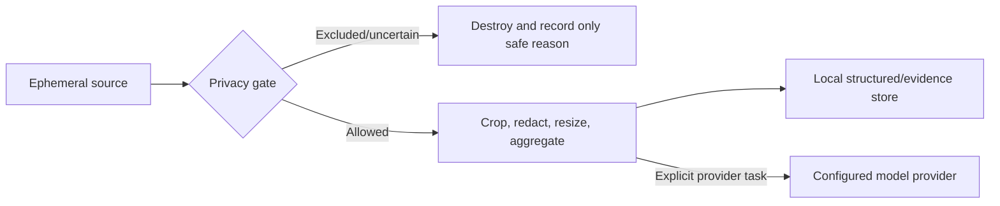

# Privacy and Security

## Principles

Dayday observes unusually sensitive local context. Privacy is therefore an architectural boundary,
not a settings-page promise.

- Local-first: structured history and artifacts are stored on the user's Mac.
- Owner-directed completeness: the private profile collects the richest confirmed local signal
  that materially improves personal memory, while retaining credential and replay exclusions.
- Explicit purpose: work-report, journal, insights, and external-Agent access use distinct data
  projections.
- User agency: each collector is independently understandable, pausable, exportable, and clearable.
- No hidden transfer: network destinations and requested model work are visible and configurable.
- No behavioral judgment: the product reports observed facts and user-authored mood, not focus,
  productivity, distraction, or inferred emotion.

## Threat model

The initial threat model covers:

- accidental capture of credentials, private/incognito browsing, messages, or excluded apps;
- a provider receiving more screen context than the user intended;
- work-report generation leaking private journal or mood data;
- local malware or another user/process reading the database, evidence, or API token;
- a local-network caller reaching an over-permissive API;
- logs, backups, exports, or diagnostics reintroducing data that normal storage avoids;
- database or file-retention bugs leaving orphaned sensitive evidence;
- model output presenting weak inference as objective fact.

V0.1 relies on macOS account security and FileVault for at-rest database/file protection. It does
not claim protection from malware executing as the same user. API/integration secrets receive
additional Keychain protection.

The production database is prepared under the current user's Application Support directory. The
Dayday directory is converged to `0700`; the database and existing SQLite journal/WAL/SHM artifacts
to `0600`; extended ACLs are rejected at the base and removed from Dayday-owned artifacts. Symbolic
links, hard-linked files, special files, unexpected owners, and unsafe shared bases fail closed
without deleting or resetting user data. SQLite's macOS Unix VFS is regression-tested to derive
new sidecars from the secured database mode even under a permissive umask.

This boundary prevents accidental cross-account exposure and unsafe restored paths. After the
preparer closes its verified file descriptors, SQLite reopens the returned URL; malicious code
already executing as the same user can still race or replace that path. That same-user attacker is
outside the V0.1 threat model and remains a reason to rely on account security and FileVault.

## Permission and consent model

On first run, Dayday explains and requests capabilities separately:

- screen understanding;
- application/window context;
- Chrome context;
- keyboard aggregate counts;
- mouse/scroll aggregate counts;
- calendar and reminders;
- weather and optional city-level location.

The personal test build uses the Owner Deep Capture profile defined by ADR 0024. After one concise
first-run explanation, it starts a guided authorization run for all supported collectors. It does
not add a separate product-confirmation step before each macOS prompt. Each collector still has an
independent status, pause, retention explanation, export path, and clear action. The menu bar makes
active collection and global pause state visible. Revoked OS authorization is a state to surface
and recover from, not a reason to repeatedly prompt or silently degrade.

## Prohibited collection

Dayday must never persist or intentionally transmit the following replayable or credential-bearing
sources, including in Owner Deep Capture mode:

- typed text, individual key-event order, or reconstructed keystrokes;
- exact timestamped mouse trajectories or click-coordinate history;
- password, authentication, payment, CAPTCHA, secure-input, lock, or login screens;
- API keys, access tokens, private keys, recovery phrases, or detected secret material;
- password-manager content;
- Chrome incognito context, credential/form-field values, or unclassified query strings/fragments;
- raw original-resolution screenshots under any normal, pinned, or Debug retention mode;
- audio, microphone content, camera content, or clipboard history.

The private profile may persist redacted visible text from allowed application windows, rendered
web pages, and author-selected chat applications in a dedicated content/evidence archive. This is
screen/application observation, not key interception. It must carry source, time, provenance, and
redaction state, and it must pass credential, secure-input, private-browsing, and source-policy
checks before storage or a BYOK request.

Microphone/camera *in-use state* may be recorded as an objective system fact when enabled; no media
is captured. Keyboard heat maps use unordered physical-key counts only. Application-level keyboard
statistics contain totals, not per-key distributions.

## Privacy gate

Every capture path passes through the same fail-closed privacy gate before persistence, OCR, model
upload, or diagnostic inspection.

The gate evaluates global pause, lock/login, secure input, incognito state, configured app/site
exclusions, password managers, sensitive accessibility roles, known secret patterns, and provider
task policy. If exclusion state cannot be established safely, it skips visual/OCR/model processing.
Exclusion decisions must not log the sensitive pixels or text that caused the decision.

Users can configure excluded applications and Chrome sites. “Do not exclude” preferences cannot
override mandatory system protections such as secure input, authentication screens, or incognito.

## Screen data lifecycle

1. Dayday's own application/windows are excluded by the ScreenCaptureKit content filter. When a
   Dayday window is active or key, all display targets are withdrawn and in-flight local OCR is
   cancelled before the editor handles further input. The five-second display-topology refresh is
   also suspended until the host is no longer being interacted with.
2. ScreenCaptureKit supplies an original frame in volatile memory only.
3. The privacy gate excludes or allows it.
4. Local processors compute change hashes, OCR, redaction, and evidence/model derivatives.
5. A selected derivative may be stored in a compressed, reduced-resolution evidence store.
6. The original memory buffer and all unselected temporary derivatives are destroyed immediately
   after the processing attempt, including on cancellation or error.

EvidenceFrames expire after seven days by default and are also subject to a configurable capacity
limit. Oldest non-pinned evidence is removed first. Pinning is explicit and visibly changes the
retention policy, but it can retain only a compressed, redacted derivative. Debug samples follow
the same rule, are separately enabled, local-only, redacted, and easy to clear.
Deletion is transactional across database metadata and the file store, with periodic orphan scans.

## Keyboard and mouse privacy

Raw input callbacks feed in-memory accumulators only:

- physical keyboard counts are accumulated without order or final character reconstruction;
- per-application data stores only total key count;
- clicks, scrolling, and distance are accumulated into hourly summaries;
- pointer/click heat maps use normalized display grids, not replayable coordinates;
- no individual input event is written to SQLite, a log, crash report, or model request.

After secure-input and source exclusions, an application-specific or Accessibility observer may
compute text-production deltas in memory and persist only aggregates: inserted/deleted scalar or
grapheme counts, estimated words, correction totals, and writing intervals. It must not persist the
characters, their order, an input-field snapshot, or enough timestamp detail to reconstruct text.

Dayday is a mandatory exclusion for the production Accessibility foreground monitor: its window
content is classified without querying or observing the host process. The local journal editor is a
separate trusted aggregate source and reports only finalized grapheme counts after input-method
composition. This preserves the owner's exact daily character total without sending journal text
through Accessibility, work-context collection, logs, or persistence.

Accumulation is disabled during global pause, lock/login, secure input, password-manager use,
incognito, and user exclusions. Hourly aggregates roll up to daily aggregates after 180 days. AI
does not use these signals to infer emotion, productivity, focus, or intent by default.

## Work and personal data isolation

WorkReport and JournalEntry share a Day identifier but not a generation context.

- `WorkReportContextRepository` exposes only Activities, work notes, allowed agenda/reminder facts,
  confirmed todos, and optional WeatherSnapshots as objective environment data.
- It has no methods returning JournalEntry, JournalFragment, JournalAttachment,
  JournalDerivedVersion, or MoodEntry.
- Work-report provider requests are constructed only from `WorkReportContext`.
- Storage-level integration tests assert that private personal records cannot appear in that
  projection or serialized provider request.
- External work-context API/MCP capabilities use the same projection.
- Weather in this projection is factual context only and cannot be used to infer mood or claim a
  causal effect on work.

The journal may show an optional, default-collapsed work-background view, but it is a read-only UI
reference. Journal prose is user-authored. Explicit AI rewrite/continuation creates a separate
derived version; it cannot overwrite the original. Private journal images are not sent for visual
analysis by default.

## Network policy

No remote telemetry, analytics, diagnostics, or account service is required. Network access is
allowed only for user-enabled purposes:

- BYOK model providers;
- weather retrieval;
- explicitly configured future integrations;
- locally bound Chrome, HTTP API, and MCP connections.

Before model transmission, Dayday uses representative frames, local OCR, crops, redaction, and
deduplication to minimize content. Provider destinations, models, transmitted image counts,
dimensions/detail, token usage, and estimated cost are recorded locally. Reaching a budget stops
new remote inference while local objective collection continues.

Weather defaults to a manually selected city and does not request location permission. Optional
location use stores only city-level context and does not create a movement history. Provider
attribution and terms are surfaced where required.

## Secrets and authentication

- Provider API keys, Chrome bridge secrets, local API bearer credentials, and integration tokens
  live in macOS Keychain with the narrowest practical accessibility class.
- Secrets are never included in databases, JSON backups, Markdown exports, logs, prompts, or UI
  copy-to-clipboard actions unless the user explicitly manages the secret itself.
- The app redacts common secret formats from captured/OCR/model context and diagnostics.
- Credential rotation invalidates the old local API/bridge session.

The local API and MCP listener bind only to `127.0.0.1`/`::1`, reject missing or invalid bearer
credentials, rate-limit requests, validate bounded time ranges, and enforce capability scopes. It
does not offer LAN mode in v0.1. Sensitive evidence access is disabled by default; delete, bulk
mutation, and settings mutation are not exposed. State-changing operations that are exposed require
confirmation in the app.

## Logging, diagnostics, backups, and exports

Release logs are local, rotating, and limited to operational state and safe identifiers. They must
not contain OCR text, screenshots, journal/report bodies, URLs beyond explicitly safe normalized
domains, secrets, or raw input events. Debug inspection follows the same prohibited-data rules even
when it shows richer decisions and model metadata.

Automatic backups are local and rolling. JSON export omits login state, API keys, tokens, and
original screenshots; including detailed context or evidence is an explicit export choice. Journal
and report Markdown exports copy only selected attachments. Imports validate version, size,
identifiers, and paths before mutation and never restore secrets or browser login state.

API/MCP audit logs record time, caller/capability, operation, outcome, and affected opaque IDs. They
do not mirror sensitive request/response bodies.

## User deletion and retention

The user can clear a data type or date range without clearing unrelated artifacts. Destructive UI
shows scope and confirmation. Retention jobs are deterministic, resumable, and tested against:

- evidence file and metadata consistency;
- pinned/debug exceptions;
- hourly-to-daily input rollups;
- report/activity references to expired evidence;
- backup/export exclusions;
- journal/work separation.

Expired evidence leaves an explicit “expired by policy” reference so conclusions remain auditable
without retaining the image.

## Security verification requirements

At minimum, automated tests cover:

- every mandatory exclusion and a fail-closed unknown state;
- no raw key/mouse event persistence or logging;
- secret-pattern redaction before OCR/model/diagnostic serialization;
- WorkReportContext exclusion of journal and mood data;
- loopback binding, bearer rejection, scopes, query bounds, and mutation confirmation;
- evidence cleanup, capacity enforcement, proof that original frames never reach disk, and
  crash/cancellation cleanup of temporary derivatives;
- backup/export omission of secrets and prohibited data;
- ModelUsage accuracy and budget behavior.

Before a public build, perform a macOS privacy-permission review, dependency/license review, local
API threat review, and release-binary check for telemetry SDKs and development endpoints.
